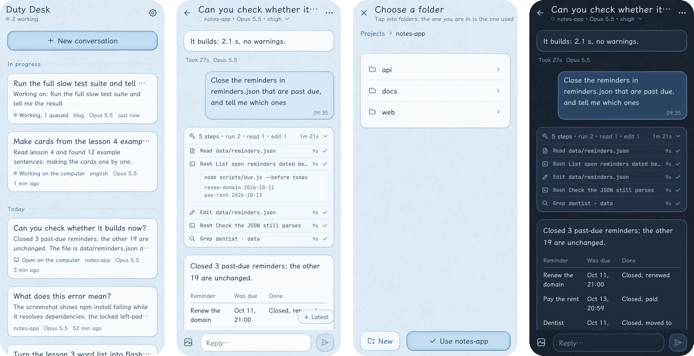
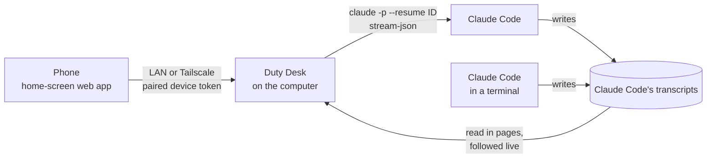

# Duty Desk

Use Claude Code on your computer from your phone, over your own network.

Duty Desk is a small server that runs next to Claude Code, plus a web app you add to your phone's home screen. The phone lists the conversations your computer already has, shows them in full, and lets you carry them on or start new ones. The work still happens on the computer: the same Claude Code, the same settings, the same login. Nothing goes through anyone else's server.



[中文说明](README.zh-CN.md)

## What you get

- **Every conversation on the computer**, newest first, with its folder and model. Conversations that are working sit at the top; ones open in a terminal are marked.
- **The whole history.** Your prompts, the replies (Markdown, tables, code) and every tool call, folded into one line per turn that counts the steps by kind and times them. Tap to see each command and its output. Transcripts are read from the end in pages, so a 300 MB one opens as fast as a short one.
- **Carry on any conversation.** It resumes the same session by its id; nothing is copied. Keep writing while it works and the messages queue up. Stop it, or attach pictures.
- **Watch the computer work.** A conversation running in a terminal on the computer shows up on the phone as it happens.
- **Start new conversations.** Tap through your project folders to pick one, or make a new folder right there. Choose the model and the effort (`low`, `medium`, `high`, `xhigh`, `max`); the defaults are the computer's own.
- **A notification when a turn ends** while you're away, through [ntfy](https://ntfy.sh). It says that something finished and how long it took. The conversation's title is left out unless you allow it.
- **Light and dark**, both drawn by hand, following the phone. A theme is a folder of colours and drawings, so you can add your own.
- **English and Chinese.** Each phone picks its own.
- **Suggestions from your own scripts.** A watcher or build bot on the computer can write a JSON file of things worth starting; they show at the top of the desk and start with one tap. See [Suggestions](#suggestions).
- **No app store.** It installs to the home screen on iPhone and Android.

## What you need

- Claude Code, signed in, on the computer.
- Node.js 20 or newer.
- The phone on the same network as the computer: the same Wi-Fi, or both on [Tailscale](https://tailscale.com).

It is tested on Windows and Linux; macOS should work the same way but hasn't been tried yet. The keep-it-running script is for Windows; elsewhere use your service manager.

## Install

```sh
git clone https://github.com/luoy16002-svg/cc-phone-bridge.git
cd cc-phone-bridge
npm install      # also builds the fonts, icons and scripts the page serves
npm start
```

Then pair the phone:

1. On the computer, open <http://127.0.0.1:8060/pc>. It shows a 6-digit code and a QR code. This page only opens on the computer itself.
2. Scan the QR code with the phone. On iPhone tap **Share → Add to Home Screen**; on Android use the browser menu's **Add to Home screen**.
3. Open Duty Desk from the home screen and enter the code.

To pair another device later, open **Settings → Pair another device** on one that is already paired.

### Keep it running

- **Windows:** `pwsh -File install-task.ps1` registers a scheduled task that starts the server at logon without a window and restarts it if it stops. `-Remove` takes it away again.
- **macOS and Linux:** run `node server.mjs` under launchd, systemd or pm2.

## Settings

Everything has a default. To change something, put it in `config.json` in the data folder: `%LOCALAPPDATA%\cc-phone-bridge` on Windows, `~/.local/share/cc-phone-bridge` elsewhere, or wherever `CCPB_DATA` points. [`config.example.json`](config.example.json) shows every key. Paths may use `~` and `%VARS%`.

| Key | Default | |
|---|---|---|
| `port` | `8060` | |
| `roots` | your home folder | Folders the phone may browse and make folders in. The first is where browsing starts. |
| `claude.command` | `claude` | The Claude Code program. On Windows this must be `claude.exe` (the native installer puts it in `%USERPROFILE%\.local\bin`). |
| `claude.configDir` | `CLAUDE_CONFIG_DIR` or `~/.claude` | Where Claude Code keeps its settings and transcripts. |
| `claude.permissionMode` | Claude Code's own | Passed as `--permission-mode`. See [Permissions](#permissions). |
| `claude.env` | | Extra environment variables for Claude Code. |
| `claude.resumeCommand` | `claude --resume {id}` | The command the phone shows for picking a conversation up in a terminal. |
| `models`, `efforts` | Opus, Sonnet, Haiku, Fable; `low` to `max` | What the phone offers. |
| `theme` | `auto` | A folder in `public/themes`, or `auto` for `autoThemes.light` and `.dark`, following each phone. |
| `timeZone` | the computer's | Times on the phone are shown in this zone. |
| `lang` | the computer's | The language of notifications (`en` or `zh`). Each phone picks its own screen language. |
| `push.ntfyTopic` | off | An ntfy topic for notifications. Pick a long random one: anyone who knows it can read it. |
| `push.includeTitle` | `false` | Put the conversation's title in the notification. |
| `tls.cert`, `tls.key` | off | Serve HTTPS with your own certificate, for example from `tailscale cert` or mkcert. |
| `extraHosts` | | Extra host names the server answers to (it already accepts its own name, `localhost` and `*.ts.net`). |
| `suggestions.file` | off | A JSON file other programs write; see [Suggestions](#suggestions). |
| `limits` | | Idle minutes before a process closes (20), processes at once (3), how long pictures from the phone are kept (7 days, 200 MB), log size (1 MB). |

## Suggestions

Point `suggestions.file` at a JSON file and any program on the computer can put a card at the top of the desk:

```json
{
  "items": [
    {
      "id": "build-1842",
      "title": "cafe-site nightly build failed",
      "detail": "3 images over 400 KB",
      "link": "https://ci.example.com/builds/1842",
      "cwd": "C:\\Users\\me\\Projects\\cafe-site",
      "prompt": "Look at why the nightly build failed and fix it",
      "created": 1760534400,
      "expires": 1760541600
    }
  ]
}
```

The card shows the title, the detail and the folder. **Start** begins a new conversation in `cwd` with `prompt`, using the computer's default model and effort; **Look** opens `link` (https only); **Dismiss** hides it for good. `id` is letters, digits and `.:_-`; `cwd` must be inside `roots`; cards past `expires` (seconds since 1970) are left out. The desk updates within a few seconds of the file changing. Nothing starts by itself: a conversation begins only when someone taps Start on a paired phone.

## How it works



- The list and the history come straight from Claude Code's own transcripts (`<configDir>/projects/<folder>/<session>.jsonl`). Duty Desk keeps no copy of any conversation.
- A message from the phone runs `claude -p --input-format stream-json --output-format stream-json --resume <id> --model <model> --effort <effort>` in the conversation's folder. The process stays up between messages and closes after 20 idle minutes; at most 3 run at once.
- While a phone has a conversation open, its transcript is followed every 1.5 seconds, so a turn started in a terminal shows up live. Claude Code's session registry says which conversations are open in a terminal and which are busy.
- The page is plain JavaScript without a framework. [marked](https://marked.js.org) and [DOMPurify](https://github.com/cure53/DOMPurify) render the Markdown; fonts and icons are served by the computer.

## Security

A paired phone can do whatever Claude Code on your computer can do. Duty Desk is built to keep that inside your own network:

- Only loopback, private LAN (10/8, 172.16/12, 192.168/16) and Tailscale (100.64/10) addresses may connect, and the `Host` header must name this computer, which stops web pages from reaching it through DNS rebinding.
- The pairing code appears only on the computer's own page, works once, expires after ten minutes, and wrong guesses are limited. Each device gets a random token; the server keeps only its SHA-256 hash. Remove a device from the computer's page or from the phone.
- The phone can browse and make folders only inside `roots`. Links are followed before that check.
- Pages are served with a strict Content-Security-Policy and load nothing from other sites. The token travels in a header, never in a URL.
- On a home network the traffic is plain HTTP. If you don't trust the network, use Tailscale or set `tls`.
- Don't forward the port to the internet.

### Permissions

The phone can't answer Claude Code's permission prompts. In Claude Code's default mode, a tool that would ask is refused, and Claude is told so. If you want more from the phone, set `claude.permissionMode` (for example `acceptEdits`), or allow the tools you want in Claude Code's own settings.

## Disk and memory

- No database and no copies of conversations. Writes are rare: the device list at most once every ten minutes, logs capped at 1 MB with one old copy, pictures from the phone kept 7 days within 200 MB.
- The served files take about 15 MB, almost all of it the text font ([LXGW WenKai Screen](https://github.com/lxgw/LxgwWenKai-Screen)), split by character range so a phone downloads only the pieces it shows.

## Themes

A theme is a folder in `public/themes/<id>/`. Its `theme.json` holds the colours, the ink and wash colours for the drawings, and its names. `python build/notebook_art.py` (needs Pillow and NumPy) draws its paper and frames and writes its `theme.css`. Pick it on the phone, or set `theme` to make it the default.

## Development

- `npm test`: 73 end-to-end checks against a fake Claude Code that writes real transcript files (no usage spent), then a check that every string on screen has an English entry.
- `node test/real.mjs`: a short run with the real Claude Code (Haiku, low effort, a temporary folder).
- `node test/shots.mjs --lang en`: screenshots of every screen at phone and desktop size (needs Playwright with WebKit).

## License

MIT. Bundled at install time: LXGW WenKai Screen and JetBrains Mono (SIL Open Font License 1.1), Tabler Icons (MIT), marked (MIT), DOMPurify (Apache 2.0 or MPL 2.0).

Duty Desk is an independent project. It is not made or endorsed by Anthropic.
