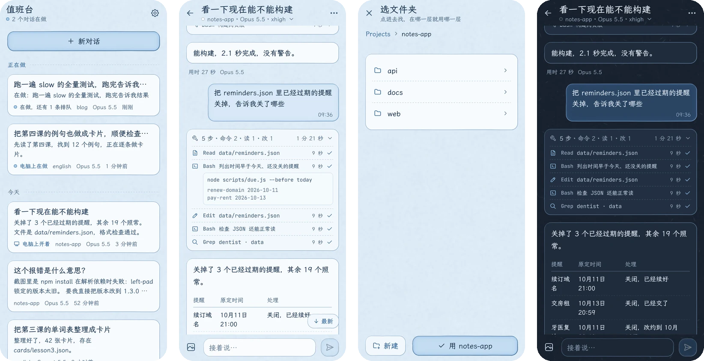

# 值班台

在手机上用电脑里的 Claude Code，只走你自己的网络。

值班台是一个和 Claude Code 放在同一台电脑上的小服务，加一个添加到手机主屏幕的网页应用。手机上能看到电脑里已有的全部对话，完整地读，接着聊，或者开新的。活还是在电脑上干：同一个 Claude Code，同一套设置，同一个登录。中间不经过任何别人的服务器。



[English](README.md)

## 能做什么

- **电脑上的全部对话**，最近的在前，标着文件夹和模型。正在做的排在最上面，在电脑终端里开着的会标出来。
- **完整的历史**：你的输入、回复（Markdown、表格、代码）和每一次工具调用。一轮里的工具调用折成一行，按类别计数、标出用时，点开能看每一步的命令和输出。记录从末尾分页读，300 MB 的记录和短的一样快。
- **接着聊任何一个对话**：用原来的编号续上同一个会话，不复制。它在做的时候可以接着写，消息会排队；可以停下，可以附图片。
- **看电脑在做什么**：在电脑终端里跑着的对话，手机上实时跟着显示。
- **开新对话**：一层层点进项目文件夹来选，或者就地新建一个；选模型和思考强度（`low`、`medium`、`high`、`xhigh`、`max`），默认和电脑上一样。
- **做完提醒**：你没在看的时候一轮做完了，经 [ntfy](https://ntfy.sh) 推一条提醒，只说做完了和用时；对话标题默认不带。
- **浅色和深色**两套手绘主题，跟着手机切换。主题就是一个放颜色和画的文件夹，可以自己加。
- **中文和英文**，每台手机自己选。
- **不用应用商店**：iPhone 和安卓都能添加到主屏幕。

## 需要

- 电脑上装好并登录了 Claude Code。
- Node.js 20 或更新。
- 手机和电脑在同一个网络里：同一个 Wi-Fi，或者都在 [Tailscale](https://tailscale.com) 上。

在 Windows 和 Linux 上测过；macOS 应该一样能跑，还没试过。常驻脚本是给 Windows 的；别的系统用自己的服务管理。

## 安装

```sh
git clone https://github.com/luoy16002-svg/cc-phone-bridge.git
cd cc-phone-bridge
npm install      # 顺带生成页面要用的字体、图标和脚本
npm start
```

然后配对手机：

1. 在电脑上打开 <http://127.0.0.1:8060/pc>，那里有 6 位配对数字和二维码。这一页只有这台电脑自己能打开。
2. 用手机扫码。iPhone 点 **分享 → 添加到主屏幕**；安卓在浏览器菜单里选 **添加到主屏幕**。
3. 从主屏幕打开值班台，填配对数字。

以后要配另一台设备：在已经配好的设备上打开 **设置 → 给另一台设备配对**。

### 常驻

- **Windows**：`pwsh -File install-task.ps1` 注册一个计划任务，登录时无窗口启动，停了会自己重启。加 `-Remove` 去掉。
- **macOS 和 Linux**：用 launchd、systemd 或 pm2 跑 `node server.mjs`。

## 设置

都有默认值。要改的话写进数据文件夹里的 `config.json`：Windows 是 `%LOCALAPPDATA%\cc-phone-bridge`，别的系统是 `~/.local/share/cc-phone-bridge`，或者 `CCPB_DATA` 指的地方。所有项见 [`config.example.json`](config.example.json)，各项的意思见[英文说明](README.md#settings)。路径里可以用 `~` 和 `%变量%`。

常改的几项：

- `roots`：手机能浏览、能新建文件夹的地方，默认是你的用户文件夹。
- `claude.command`：Claude Code 程序。Windows 上要指向 `claude.exe`（原生安装在 `%USERPROFILE%\.local\bin`）。
- `claude.permissionMode`：传给 `--permission-mode`，见下面的“权限”。
- `timeZone`：手机上的时间按这个时区显示。
- `push.ntfyTopic`：做完提醒用的 ntfy 主题，起一个长的随机名字，知道名字的人都能读到。
- `tls.cert`、`tls.key`：用自己的证书开 HTTPS，比如 `tailscale cert` 或 mkcert 生成的。
- `suggestions.file`：别的程序写的建议文件。电脑上的脚本（比如找活的监控、构建机器人）往里写想做的事，值班台首页最上面就会出现卡片，点“开始”就在那个文件夹里用它写好的要求开一个新对话；点“不用了”就不再显示，过期的自动消失。不点就什么都不会启动。文件格式见[英文说明](README.md#suggestions)。

## 安全

配好的手机能做的事，和电脑上的 Claude Code 一样多。值班台把这些都关在你自己的网络里：

- 只接受本机、局域网（10/8、172.16/12、192.168/16）和 Tailscale（100.64/10）的连接，`Host` 头必须是这台电脑，网页没法用 DNS 重绑定摸进来。
- 配对数字只显示在电脑自己的页面上，用一次就失效，十分钟过期，猜错次数有限。每台设备拿到一个随机令牌，服务器只存它的 SHA-256 哈希。电脑页面和手机上都能移除设备。
- 手机只能在 `roots` 里浏览和新建文件夹，链接先解析到真实位置再检查。
- 页面带严格的 Content-Security-Policy，不从别的网站加载任何东西。令牌放在请求头里，不进网址。
- 家里网络上走的是明文 HTTP。信不过这个网络，就用 Tailscale 或者配 `tls`。
- 不要把端口转发到公网。

### 权限

手机没法回答 Claude Code 的权限询问。在 Claude Code 的默认模式下，需要询问的工具会被拒绝，Claude 会知道这一点。想让手机上能做更多，设 `claude.permissionMode`（比如 `acceptEdits`），或者在 Claude Code 自己的设置里放行要用的工具。

## 硬盘和内存

- 没有数据库，不存对话的副本。写盘很少：设备列表最多十分钟写一次，日志上限 1 MB、留一份旧的，手机传的图片留 7 天、总共不超过 200 MB。
- 页面文件大约 15 MB，几乎都是正文字体（[霞鹜文楷 Screen](https://github.com/lxgw/LxgwWenKai-Screen)），按字符分片，手机只下载显示到的那几片。

## 主题

主题是 `public/themes/<id>/` 里的一个文件夹。`theme.json` 写颜色、画框和纸面用的墨色与水彩色、名字；`python build/notebook_art.py`（要 Pillow 和 NumPy）画纸面和边框，生成 `theme.css`。在手机上选，或者在配置里设 `theme` 当默认。

## 开发

- `npm test`：用假的 Claude Code（像真的一样写记录文件，不花用量）跑 73 项端到端检查，再检查界面上每句话都有英文。
- `node test/real.mjs`：用真的 Claude Code（Haiku，低强度，临时文件夹）跑一小段。
- `node test/shots.mjs --lang zh`：手机和桌面尺寸下每个页面的截图（要装带 WebKit 的 Playwright）。

## 许可

MIT。安装时一起打包的：霞鹜文楷 Screen 和 JetBrains Mono（SIL Open Font License 1.1）、Tabler Icons（MIT）、marked（MIT）、DOMPurify（Apache 2.0 或 MPL 2.0）。

值班台是独立项目，不是 Anthropic 做的，也没有得到 Anthropic 的背书。
